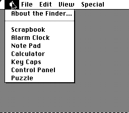
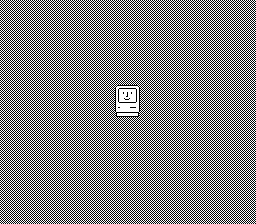
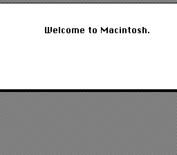
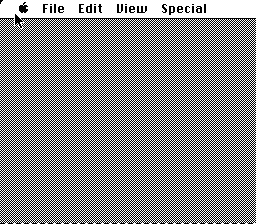
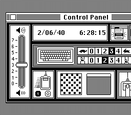

# snesmac

Boot a **Macintosh 128K** — System, Finder and all — on a stock, unmodified **Super Nintendo**.

snesmac runs a real 1984 Macintosh ROM on the SNES's 65816. It emulates the Mac's
Motorola 68000 in portable C, models enough of the machine (VIA, video, the overlay,
the 60 Hz VBL) to satisfy the boot ROM, and high-level-emulates the `.Sony` floppy
driver so it can read a System disk straight out of the cartridge. It boots System 1.1
to the **Finder desktop**. It ships as a single `.sfc` — no special cartridge chip,
no expansion hardware, just a Super Nintendo (and a lot of patience).

<p align="center">
  <br>
  <sub>The 🍎 menu, opened on a Super Nintendo — the d-pad moves the mouse, A clicks.</sub>
</p>

<p align="center">
  
  
  
  <br>
  <sub>The whole ride: Happy Mac → Welcome to Macintosh → the Finder desktop →
  the Control Panel, open and running. Every frame is the SNES's own output.</sub>
</p>

## Wait, what?

A Super Nintendo's CPU is a 16-bit 65816 at ~3.58 MHz. The Macintosh's is a 32-bit
68000 at 7.83 MHz. snesmac makes the former impersonate the latter:

- a **lean 68000 interpreter written once in portable C** (`core-c/src/m68k.c`) and
  compiled to 65816 with the [Calypsi](https://www.calypsi.cc/) C compiler — *not*
  hand-written assembly. This is the whole feasibility bet: a 68000 is far too big to
  hand-code (eight 32-bit data + eight 32-bit address registers, a huge addressing-mode
  matrix, a 32-bit ALU), but it's very tractable in C;
- an **HLE `.Sony` disk driver** — instead of emulating the IWM controller and GCR
  track encoding, snesmac intercepts the Mac's disk OS traps and serves 512-byte
  sectors directly from a disk image in the cartridge. The ROM's own File Manager does
  the rest and boots normally;
- the Mac's **128 KB of RAM lives in cartridge SRAM**, and its 64 KB ROM + 400 KB
  floppy are **embedded in the cartridge ROM** — the 68000's whole world, mapped into
  a SNES cart;
- **the exact same machine model runs on the host**, so a Mac that boots in `runmac`
  on your desktop boots on the SNES too.

See [docs/INTERNALS.md](docs/INTERNALS.md) for how it all actually works.

## How do we know it's correct?

There is one 68000 core, `core-c/src/m68k.c`, held to two independent standards:

- **Instruction accuracy.** It's run against the
  [SingleStepTests/m68000](https://github.com/SingleStepTests/m68000) per-instruction
  vectors (127 opcode files, 317,500 tests) — **100 % accounted for, zero unexplained
  failures**; every non-exact case is a documented, benign class (odd-address fault
  frames, undefined-result BCD/DIV/CHK). It's cross-checked on the host against
  [Musashi](https://github.com/kstenerud/Musashi) as a second oracle.
- **The SNES port didn't change its behaviour.** The *same* C core, compiled by
  Calypsi, is run on the SNES and diffed against the host in lockstep — a per-step
  hash of the whole machine state as the real ROM boots. **PARITY OK.** (This is how
  we caught two real Calypsi code-generation bugs that host testing couldn't.)

## Try it

Load `snes/build/macboot.sfc` in an accurate emulator such as
[Mesen](https://www.mesen.ca/), or flash it to a cart. It boots on its own — Happy Mac,
"Welcome to Macintosh", then the Finder desktop.

**It is slow — but honestly slow.** The 68000 is interpreted in software on a
3.58 MHz 16-bit CPU. The default build teleports past the ROM's RAM test (the
Happy Mac shows up in moments) and the measured optimization campaign has it
~6× faster than the first boots; the desktop is still tens of minutes away in
real time — minutes with fast-forward. See
[docs/COMPATIBILITY.md](docs/COMPATIBILITY.md) for the honest numbers,
[docs/PERF.md](docs/PERF.md) for the campaign, and
[docs/FUTURE.md](docs/FUTURE.md) for where it goes next.

## Build

```sh
cd snes
make macboot        # -> build/macboot.sfc   (the live boot; needs your ROM + disk)
make test-macparity # host<->SNES parity check
```

The Mac ROM and a System disk are **not** included (Apple copyright); drop your own
dumps in `roms/` first. Full instructions in [docs/BUILDING.md](docs/BUILDING.md).

## Docs

| doc | what |
|---|---|
| [docs/INTERNALS.md](docs/INTERNALS.md) | how a 68000 runs on a 65816; the machine model; the HLE `.Sony` driver; the SNES memory layout; parity testing |
| [docs/BUILDING.md](docs/BUILDING.md) | build the host tools + the SNES ROMs; bring your own ROM/disk |
| [docs/COMPATIBILITY.md](docs/COMPATIBILITY.md) | what boots, and the honest performance picture |
| [docs/FUTURE.md](docs/FUTURE.md) | where this goes next — speed, input, SA-1 |
| [docs/PROJECT.md](docs/PROJECT.md) | the original design brief + milestone log (M0–M7) |

## Layout

```
core-c/src/      the machine: the lean 68000 core (m68k.c), the Mac model + HLE
                 .Sony driver (mac.c), and runmac.c — the host emulator.
core-c/musashi/  vendored Musashi 68000 core (MIT) — a host-only correctness oracle.
core-c/tests/    the validation harness: SingleStepTests vectors + the host<->SNES
                 parity reference generator.
snes/            the SNES ROM: Calypsi build of the same core + machine, the inline
                 memory backend (macmem.h/m68kbus.h), the hand-65816 video copy
                 (calypsi/tilecopy.s), the live boot (macboot.c), the parity ROM
                 (macparity.c) and the bench (macbench.c). make macboot -> .sfc
docs/            documentation + the design brief.
roms/            your Mac ROM + disk images (gitignored — Apple copyright).
```

## Status

- **Boots System 1.1 to the Finder desktop** on the host (`runmac`).
- **Runs live on the SNES** (verified in Mesen): the machine model is parity-clean on
  Calypsi, and `macboot.sfc` boots — Happy Mac, "Welcome to Macintosh", and onward to
  the desktop, slowly.
- The 68000 core, SNES video path, and host↔SNES parity are all validated. Real-hardware
  testing (a flashcart) is still pending — if you try it, we'd love a report.

## Legal & credits

The Macintosh 128K ROM and Apple's System / Finder are **copyright Apple** and are not
distributed here — snesmac is **bring-your-own-ROM**: the `roms/` directory (ROM and
disk binaries) is gitignored, and the build regenerates every derived artifact (parity
references, the fastboot warm state) from your own dumps.

- CPU test vectors: [SingleStepTests/m68000](https://github.com/SingleStepTests/m68000).
- [Musashi](https://github.com/kstenerud/Musashi) 68000 core (MIT, Karl Stenerud) — the
  host-side correctness oracle.
- Built with the [Calypsi](https://www.calypsi.cc/) 65816 C compiler; test/harness
  patterns shared with its sibling projects snes86 and snespico8.

Built with the help of AI.
