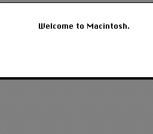
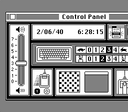

# What runs, and how fast

## What boots

**System 1.1 boots to the Finder desktop.** On the host (`runmac`) this is verified end
to end — the 🍎 File/Edit/View/Special menu bar, the "System Disk" icon, and the Trash.
On the SNES the *same* machine boots live (confirmed in Mesen): Happy Mac → "Welcome to
Macintosh" → the desktop, given enough time.

   
  "Welcome to Macintosh", live on the SNES — the ROM's <em>dsGreeting</em>, on the way to the desktop.

The boot you'll see:

| stage | what it means |
|---|---|
| **Happy Mac** | power-on self-test passed; the ROM found the disk and is booting it |
| **"Welcome to Macintosh"** | the System is loading (this is `SysError(40)` = `dsGreeting`, normal boot, not a crash) |
| **Finder desktop** | you made it |

The whole boot runs the *real* Apple ROM code — the File Manager, the Resource Manager,
QuickDraw, the Finder — on top of the emulated 68000. snesmac only fakes the disk
*hardware* (via the [HLE `.Sony` driver](INTERNALS.md#the-hle-sony-driver--how-it-reads-a-disk)),
not the software.

And once it's up, it's not a screenshot — it's a computer. With the d-pad and
**A** you can pull down menus and launch desk accessories. Here is the Control
Panel, opened and running on a Super Nintendo, volume slider, desktop-pattern
editor and all:

   
  The Control Panel, driven with a SNES controller. (The clock reads 1940:
  no battery-backed clock chip in this "Mac". Authentic behavior.)

## What doesn't (yet)

- **Mouse works; no keyboard yet.** The **d-pad** moves the cursor, a tap of **A**
  clicks (the press is stretched internally so the Mac's VBL-rate button sampling
  can't miss it), holding **A** holds the button for menu pulls and drags. Menus
  and desk accessories verified working on the SNES (see the Control Panel above).
  The cursor still lags a little — the Mac redraws it only on its VBL — but far
  less than it used to: redraws are ~13× cheaper and the machine ~6× faster since
  the first boots (see [PERF.md](PERF.md)). The **keyboard** isn't wired up yet,
  so no typing; that's next (see [FUTURE.md](FUTURE.md)).
- **One disk, read-only.** A single 400 KB System floppy is served from the cartridge.
  Writes are acknowledged but not persisted; there's no second drive.
- **The display is a 256×224 window** into the 512×342 Mac screen (the SNES can't show
  the whole 1-bit screen at 1:1 — a background addresses only 1024 tiles; the full
  screen is 2752). Two views, both live:
  - **1:1 pan** — **hold L** and the **d-pad** slides the window, to reach the menu
    bar, the disk icon, the Trash (the d-pad on its own is the mouse);
  - **zoom-out** — **tap R** to toggle the *whole screen at once*, 2×2-downscaled to
    256×171 with **four gray levels**: the normal view is 1-bit, so the second plane
    of the SNES's 2bpp mode and two spare palette entries were free, and the Mac's
    dithered desktop averages to a true gray instead of collapsing to black. Aim the
    mouse anywhere on the zoomed view, tap R again for full detail.
- **System 2.0 is untested.** Only System 1.1 has been driven all the way to the desktop.
  Later Systems (and larger/800 KB disks) haven't been tried.

## The performance picture (the honest part)

snesmac is **slow, but no longer comically slow**. The interpreted 68000 started at
~200 instructions/second (a cold boot to the desktop was ~4–5 hours); after the
measured optimization campaign in [PERF.md](PERF.md) it runs at **~1,200
instructions/second**, and the default build also **teleports past the ROM's RAM
test and boot-chime delays** (1.5 M instructions the ROM burns before its first
disk read — regenerated from your own ROM at build time, bit-equivalent resume,
`FASTBOOT=0` for the purist boot). Net effect: the Happy Mac appears in moments,
and the desktop is **tens of minutes away in real time — minutes under
fast-forward** instead of an afternoon.

Why it can't just be fast, structurally:

- **You're running a CPU interpreter, so one Mac instruction is a whole subroutine.**
  Fetch, decode, execute, write back, set flags — still ~450 generated 65816
  instructions even for a 68000 `NOP`, dominated by 32-bit arithmetic on a 16-bit
  CPU (measured with the sampling profiler; see PERF.md §8).
- **The CPUs are mismatched both ways.** The 68000 is 32-bit at 7.83 MHz; the 65816
  is 16-bit at 3.58 MHz. Every 32-bit operation becomes several 16-bit ones, on a
  slower clock.
- Every change lands with numbers from the **committable Apple-free bench ROM**
  (`make -C snes test-bench`), plus real-ROM lockstep parity against the host —
  the campaign killed as many "obvious" ideas as it confirmed, and one compiler
  flag that miscompiled the machine.

What remains before it's *comfortable*: hand-65816 for the fetch/decode/dispatch
skeleton, and the **SA-1** coprocessor (~10.7 MHz + linear RAM) as milestone M7 —
see [FUTURE.md](FUTURE.md).

## Getting a disk

Bootable 400 KB System disks in DiskCopy 4.2 format are archived at sites like
[earlymacintosh.org](https://earlymacintosh.org/disk_images.html). Convert one to raw
sectors with `core-c/tests/dc42.py` (see [BUILDING.md](BUILDING.md)). Disk images are
Apple-licensed — bring your own; they're gitignored.
